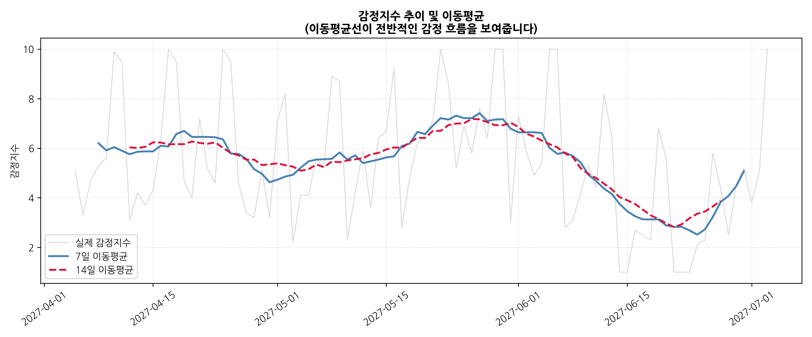
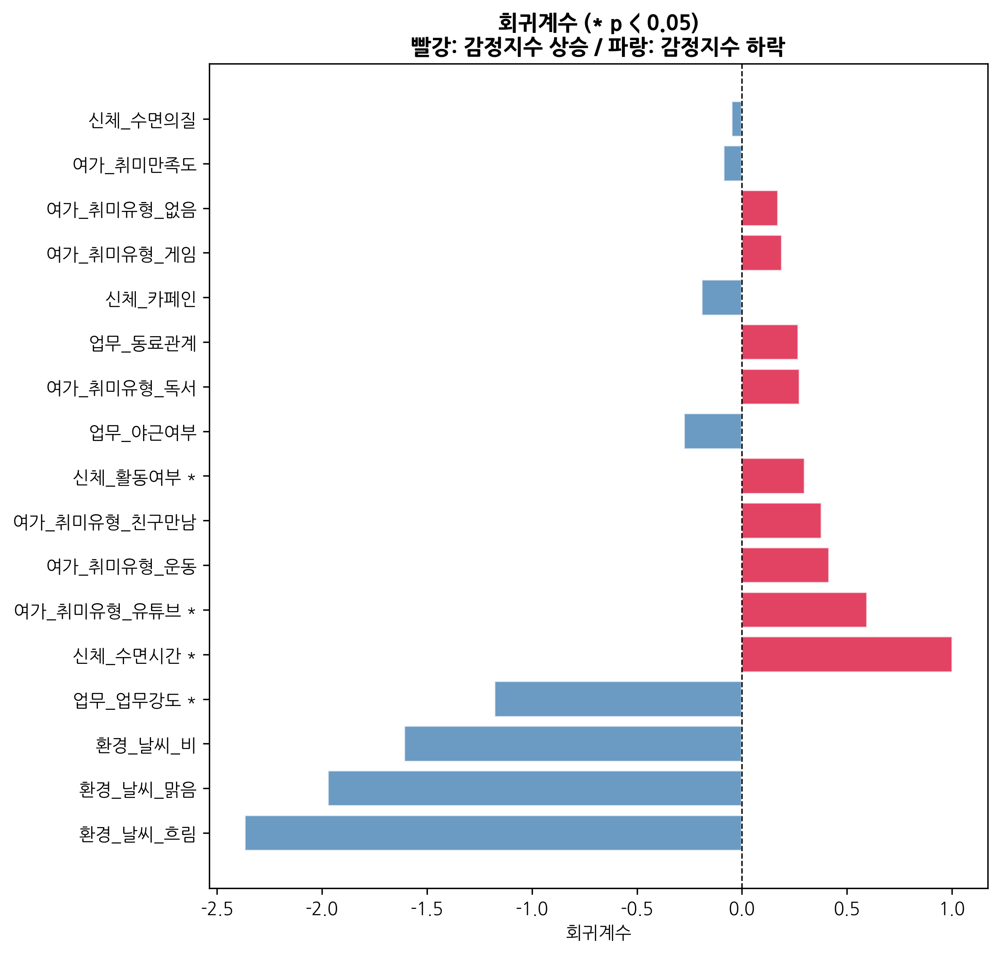
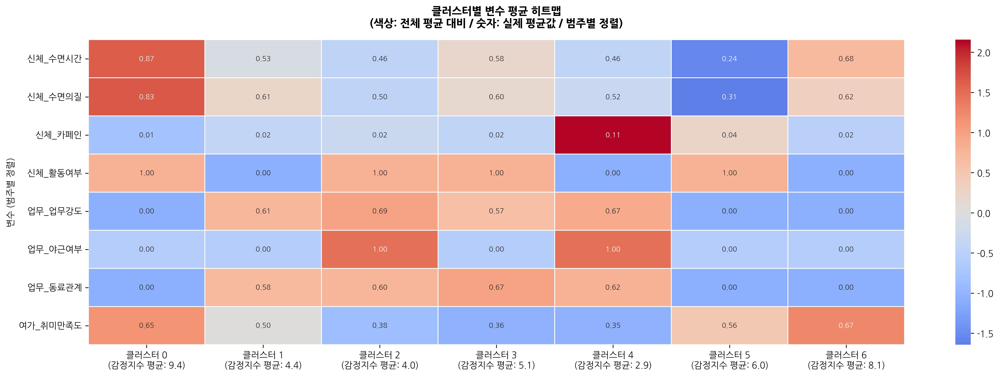
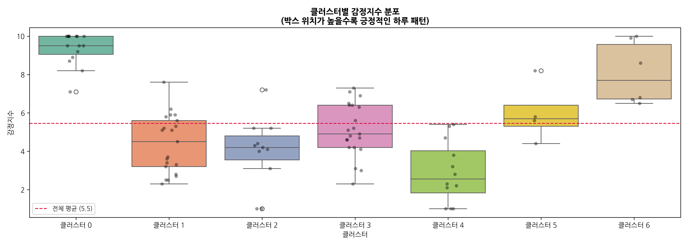
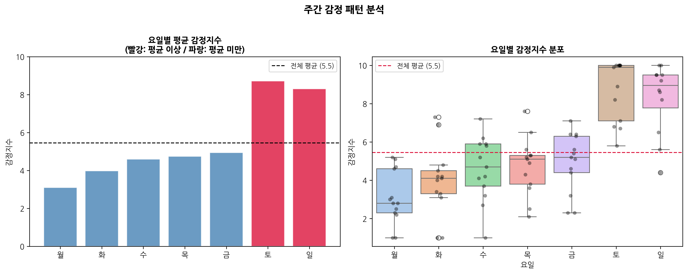
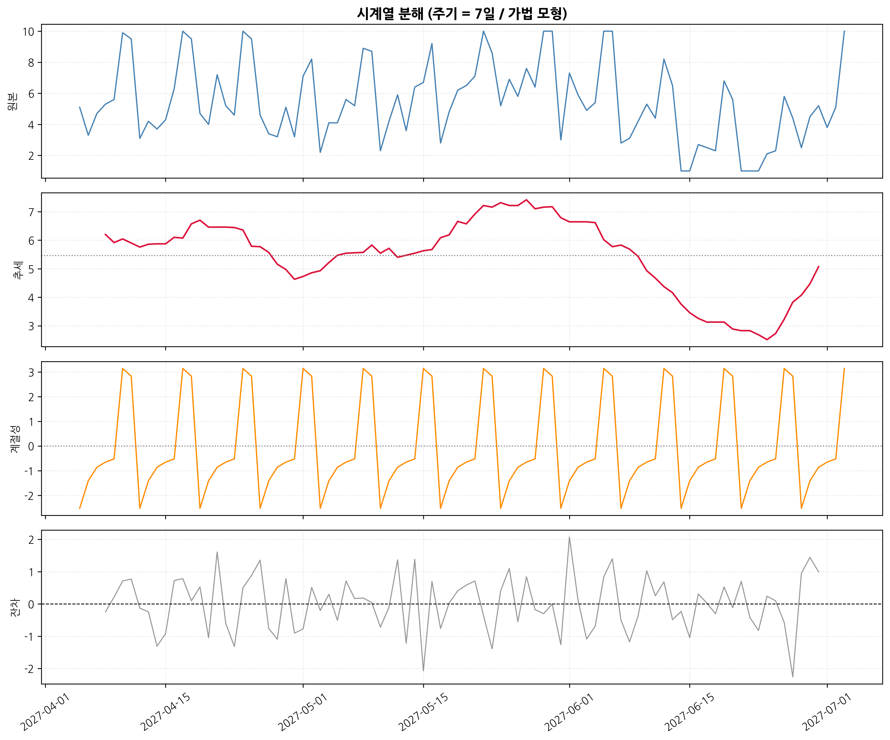
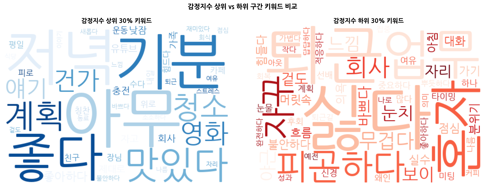
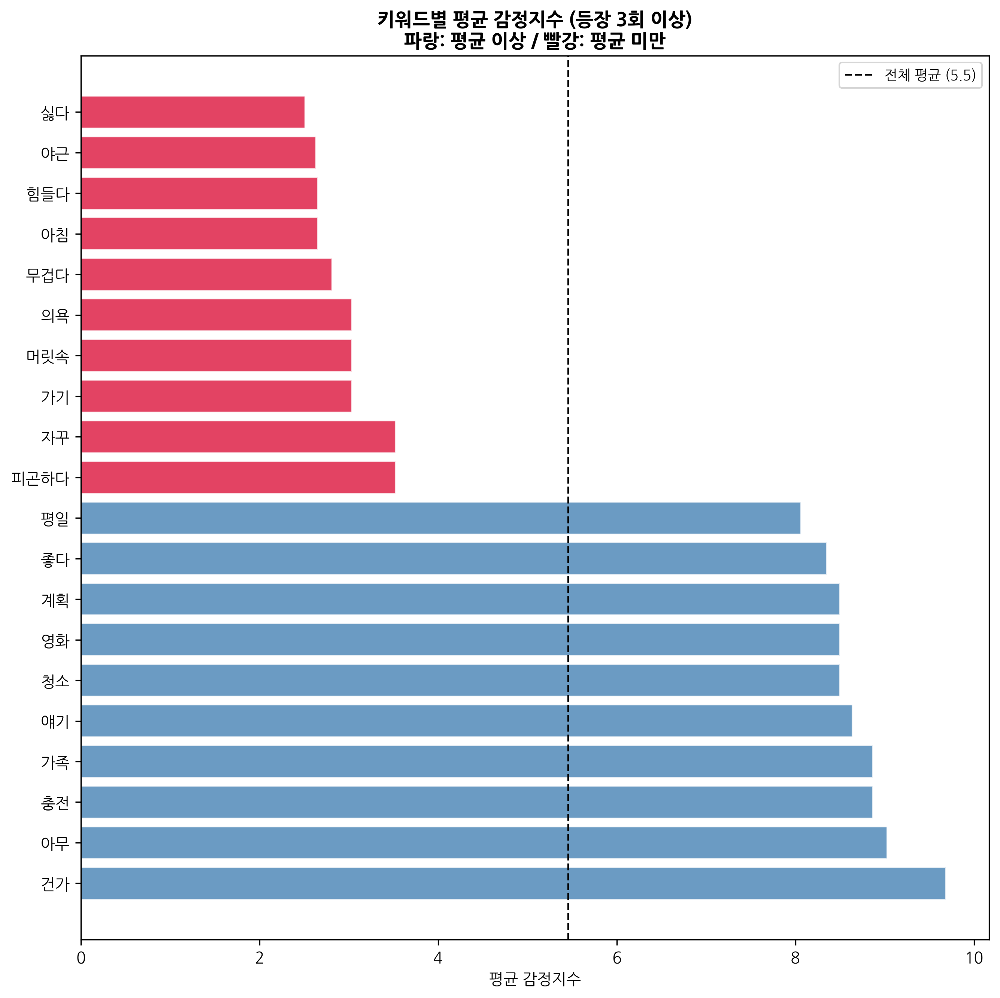
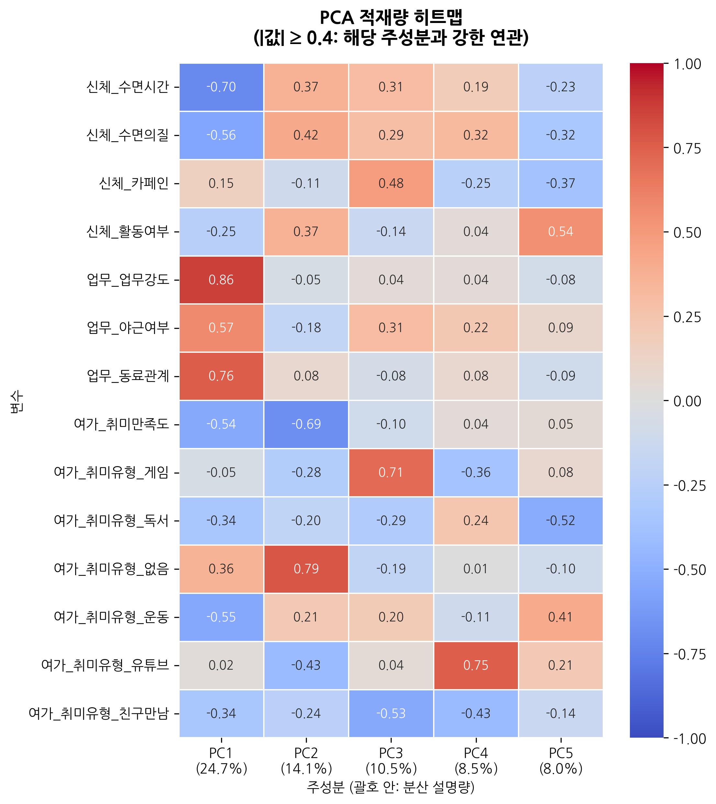
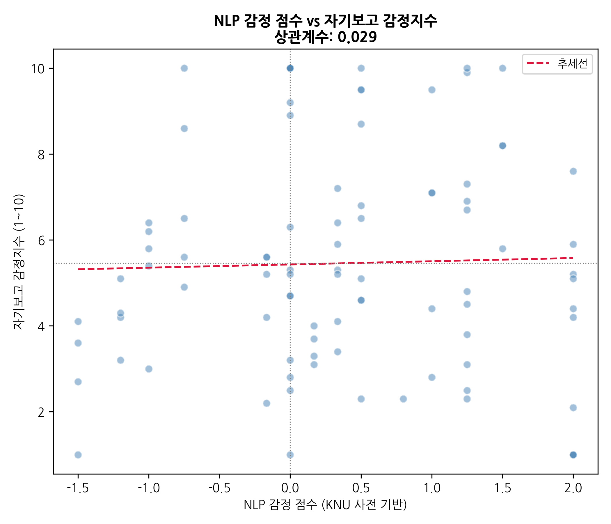

# 분석 결과 요약 (Key Findings)

> 이 문서의 결과는 `data/sample_data.csv`(가상 90일, 입사 3개월차 시나리오로 설계)에 분석 파이프라인을 적용한 것입니다.
> 가상 데이터의 패턴은 시나리오에 따라 설계된 것이므로, 결과의 의미보다 **분석 방법과 해석 기준**을 보여주기 위한 용도입니다.
> README의 "샘플 데이터로 실행" 순서대로 실행하면 같은 결과를 재현할 수 있습니다.

---

## 1. 감정지수 전반적 현황

- 분석 기간: 2027-04-05 ~ 2027-07-03 (90일)
- 평균 감정지수 5.46 / 10, 표준편차 2.55, 최고 10.0 (2027-04-17), 최저 1.0 (2027-06-14)
- 7일 이동평균 기울기 -0.0285로 기간 전체로는 하락 추세이고, 5월 하순 이후 하락 흐름이 뚜렷함
- ADF 정상성 검정 p-value 0.1011 → 5% 수준에서 정상 시계열로 보기 어려움 (추세 존재 가능)

---

## 2. 감정지수에 영향을 미치는 주요 변수 (회귀분석)

OLS 회귀분석 결과 (n = 90, 독립변수 17개)

| 지표 | 값 |
|------|-----|
| R² / Adj. R² | 0.806 / 0.760 |
| F-통계량 p-value | 3.66e-19 |
| Durbin-Watson | 1.22 (양의 자기상관 가능성) |
| VIF 최댓값 | 4.34 (모두 10 미만, 다중공선성 문제 없음) |

p < 0.05인 변수는 4개입니다. 독립변수를 표준화(`--scaler standard`)해서 계산했으므로 계수는 **독립변수가 1 표준편차 증가할 때 감정지수의 변화(점)**입니다.

| 변수 | 표준화 회귀계수 | 방향 | p-value |
|------|---------------|------|---------|
| 신체_수면시간 | +1.00 | 수면시간이 길수록 상승 | < 0.001 |
| 업무_업무강도 | -1.18 | 업무강도가 높을수록 하락 | < 0.001 |
| 여가_취미유형_유튜브 | +0.60 | 유튜브 시청한 날 상승 | 0.011 |
| 신체_활동여부 | +0.30 | 활동한 날 상승 | 0.041 |

해석 시 주의:
- R²는 학습 데이터 안에서 계산한 값이며 교차검증은 하지 않았습니다.
- Durbin-Watson이 1.22로 2보다 작아 연속된 날의 잔차가 비슷한 경향이 있습니다. 이 경우 p-value가 실제보다 낙관적으로 나올 수 있어, p = 0.011, 0.041 같은 경계값은 참고 수준으로 봅니다.

---

## 3. 하루 패턴 유형화 (클러스터링)

실루엣 점수는 k = 2에서 0.319였고 k = 7에서 0.474로 가장 높았지만, k = 6(0.472)과 차이가 거의 없어 k 선택이 안정적이지는 않습니다. (0.5 이상이면 양호)
최고점인 k = 7을 선택했습니다. 클러스터링에서는 감정지수와 텍스트 컬럼, 다중선택 파생 컬럼(여가_취미유형 6개)을 제외하고 8개 변수만 사용했습니다.

| 클러스터 | 일수 | 감정지수 평균 | 주요 특징 |
|---------|------|-------------|---------|
| 0 | 15일 | 9.4 | 활동과 수면이 좋고 업무 변수가 낮음 |
| 6 | 6일 | 8.1 | 활동은 없지만 업무가 낮고 취미 만족도가 높음 |
| 5 | 4일 | 6.0 | 활동이 있고 업무 변수가 낮으며 수면시간은 짧음 |
| 3 | 21일 | 5.1 | 활동이 있고 업무 변수는 보통 |
| 1 | 21일 | 4.4 | 활동이 없고 야근은 적음 |
| 2 | 11일 | 4.0 | 야근이 많고 활동은 있음 |
| 4 | 12일 | 2.9 | 야근이 많고 활동이 없음 |

감정지수 평균이 가장 낮은 두 클러스터(2, 4)는 모두 야근 비중이 높았습니다. 4일, 6일처럼 일수가 적은 클러스터는 안정성이 낮아 해석에 주의합니다.

---

## 4. 주간 감정 패턴 (시계열 분석)

| 요일 | 월 | 화 | 수 | 목 | 금 | 토 | 일 |
|------|----|----|----|----|----|----|----|
| 평균 감정지수 | 3.10 | 3.98 | 4.60 | 4.75 | 4.95 | 8.72 | 8.31 |
| 일수 | 13 | 13 | 13 | 13 | 13 | 13 | 12 |

요일 간 차이를 Kruskal-Wallis 검정으로 확인했습니다. (H = 50.46, p = 3.8e-09)
요일별 표본이 12~13일로 적어 정규성 가정이 필요 없는 비모수 검정을 사용했습니다. 평일은 점진적으로 오르다가 주말에 크게 높아지는 패턴입니다.

---

## 5. 감정과 연관된 키워드 (텍스트 마이닝)

사용자 정의 불용어 12개를 적용한 뒤 401개 토큰을 추출했습니다. 상위 30%(6.5점 이상, 28일)와 하위 30%(4.1점 이하, 28일)를 비교한 결과입니다. (두 그룹 합쳐 3회 이상 등장한 단어만 비교)

| 구분 | 주요 키워드 (상위 그룹 빈도 : 하위 그룹 빈도) |
|------|------|
| 감정 높은 날 | 저녁(8:0), 기분(8:0), 좋다(8:0), 맛있다(7:0), 계획(7:1), 영화(6:0) |
| 감정 낮은 날 | 싫다(0:7), 퇴근(1:6), 업무(0:5), 혼자(0:5), 무겁다(0:4), 피곤하다(0:4) |

텍스트 키워드는 빈도 기반의 참고 자료이며, 단어 간 인과를 의미하지 않습니다.

---

## 6. 요인분석 (PCA)

Kaiser 기준으로 5개 주성분을 추출했고, 누적 분산 설명량은 65.8%입니다.

- **PC1 (24.7%)**: 업무 부담 요인. 업무강도(0.86), 동료관계(0.76), 야근여부(0.57)가 양의 방향이고, 수면시간(-0.70), 수면의질(-0.56), 운동(-0.55), 취미만족도(-0.54)가 음의 방향
- **PC2 (14.1%)**: 여가 요인. 취미 없음(0.79)과 취미만족도(-0.69)가 반대 방향

---

## 7. NLP 감정 분석 (보조 분석)

KNU 한국어 감성사전 기반 텍스트 감정 점수와 자기보고 감정지수를 비교했습니다.

- 일별 텍스트 감정: 긍정 52일 / 부정 23일 / 중립 15일, 평균 0.369 (-2 ~ 2 기준)
- 두 지표의 상관계수: **0.029**
- 1~10 척도로 환산한 평균 괴리 2.71점, 최대 괴리 2027-06-15 (9.00점)

상관이 거의 없으므로, 이 사전 기반 방식은 감정지수를 잘 설명하지 못합니다. 문맥(부정, 반어 표현 등)을 고려하지 못하는 사전 기반 방법의 한계로 해석하며 참고 수준으로만 사용합니다.

---

## 종합

회귀분석과 요인분석이 같은 방향을 가리킵니다. 수면이 길고 업무 부담(업무강도, 야근)이 낮은 날 감정지수가 높았고, 요일로는 평일에서 주말로 갈수록 높아졌습니다. 반면 텍스트 기반 감정 점수는 자기보고 감정지수와 거의 연관이 없었습니다.

이 결과는 가상 샘플 데이터에 대한 것이며, 90일의 소표본과 시계열 자기상관 때문에 p-value를 낙관적으로 볼 수 있어 탐색적 결과로 해석합니다.